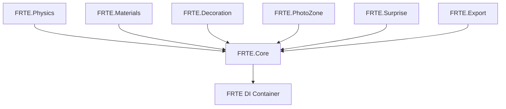

# FRTE SDK Architecture

The FRTE SDK follows a decoupled **Registry-DI** architecture. 

### Decoupling Principles
- Modules register themselves to the `FRTEContainer` during the `BeforeSceneLoad` runtime execution phase using Bootstrappers.
- Inter-module communication is driven by the thread-safe `EventBus` to prevent compile-time cross-dependencies.
